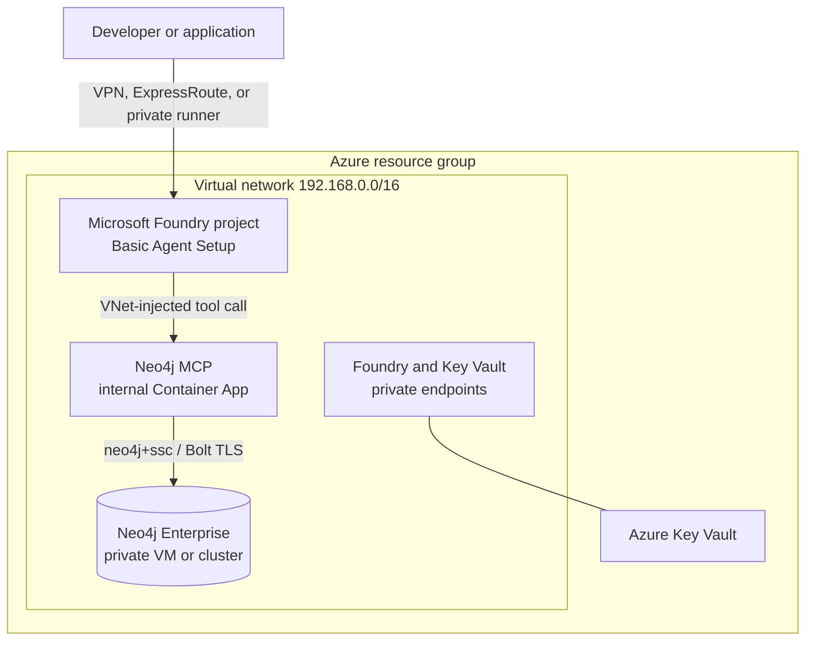

# Neo4j on Microsoft Foundry with private networking

An Azure Developer CLI (`azd`) template for connecting Microsoft Foundry agents
to Neo4j inside a private virtual network. It deploys Foundry **Basic Agent
Setup** with platform-managed agent storage, a private Neo4j MCP endpoint, and
an optional private Neo4j Enterprise database on Azure VMs.

[Features](#features) • [Getting Started](#getting-started) •
[Resources](#resources) • [Guidance](#guidance)

> [!IMPORTANT]
> This is an evaluation template, not a production reference architecture.
> Review security controls, costs, model availability, Neo4j license terms, and
> your organization's Azure policies before production use.

## Important Security Notice

This sample is secure-by-default for inbound networking: Foundry, MCP, Neo4j,
and Key Vault do not expose public application endpoints. The bundled database
uses a self-signed Bolt certificate and Neo4j Enterprise evaluation software.
Replace the certificate, harden operational access, and complete your own threat
model and compliance review before using the design with sensitive data.

The repository contains only generated wind-turbine data. It contains no real
customer, company, person, or product data.

## Features

- Microsoft Foundry Basic Agent Setup with VNet injection and platform-managed
  agent storage—no separate Azure Cosmos DB, Storage, or AI Search deployment.
- An internal Azure Container Apps environment running the version-pinned,
  official Neo4j MCP server in read-only mode by default.
- A private Neo4j Enterprise VM deployment with no public IP or inbound SSH,
  Bolt TLS, Trusted Launch, Premium SSD storage, verified release downloads,
  and explicit NAT-only egress.
- A dedicated Neo4j `reader` user for MCP plus a second read-only barrier in the
  MCP server.
- Key Vault-backed secrets and managed identity for VM secret retrieval.
- Neutral synthetic graph data and a deterministic Foundry agent test that
  exercises a real `read-cypher` MCP call.
- Cross-platform `azd` hooks for license acknowledgement, secret generation,
  secure post-provision configuration, and ordered Foundry/VNet teardown.
- GitHub OIDC deployment, Microsoft gallery validation, a tested Dev Container,
  and the standard open-source community files required by the azd gallery.

### Architecture



The VNet uses four `/24` subnets: one delegated to the Foundry agent runtime,
one for private endpoints, one delegated to the internal MCP Container Apps
environment, and one for Neo4j.

## Resources

| Resource | Purpose |
| --- | --- |
| Foundry account, project, model, and capability hosts | Basic Agent Setup with VNet injection |
| VNet and four subnets | Isolation for the agent runtime, private endpoints, MCP, and Neo4j |
| Foundry private endpoint and private DNS zones | Private account access and name resolution |
| Internal Container Apps environment and app | VNet-only Neo4j MCP endpoint |
| Log Analytics workspace | MCP platform and application logs |
| Key Vault and private endpoint | Neo4j credentials for the bundled deployment |
| One Neo4j VM by default | Low-cost evaluation database; optionally three primaries for HA testing |
| NAT gateway and public egress IP | Explicit outbound bootstrap path for the Neo4j VMs |

## Getting Started

### Prerequisites

- An Azure subscription and permission to create resources and role
  assignments: Foundry Account Owner plus Owner, or Contributor with Role Based
  Access Administrator.
- Model quota in the target region. The default is `gpt-4.1` version
  `2025-04-14`, Global Standard, 30K TPM.
- [Azure Developer CLI](https://learn.microsoft.com/azure/developer/azure-developer-cli/install-azd)
  1.31 or later, Azure CLI, OpenSSL, `ssh-keygen`, and Python 3.10 or later.
- Registered resource providers: `Microsoft.App`,
  `Microsoft.CognitiveServices`, `Microsoft.Compute`, `Microsoft.KeyVault`,
  `Microsoft.Network`, `Microsoft.OperationalInsights`, and
  `Microsoft.ContainerService`.
- A private access path such as VPN, ExpressRoute, or a VNet-connected runner to
  call the Foundry project when public network access is disabled.

The checked-in Dev Container supplies the required development tools. In a
Codespace, use device-code authentication if browser authentication is not
available. The pre-provision hook registers missing providers when the deployer
has permission. This release supports the public `AzureCloud` environment;
sovereign clouds require endpoint and availability review.

### Deploy

After publication in the Neo4j GitHub organization, initialize a new project:

```bash
azd init --template neo4j/neo4j-foundry-vnet
```

From an existing checkout:

```bash
azd auth login
az login
azd up
```

The pre-provision hook asks for explicit acceptance of the Neo4j Enterprise
license, generates strong database passwords in the gitignored azd environment,
and creates a local SSH key. The VM has no SSH endpoint.

For unattended evaluation deployments, acknowledge the license before `azd up`:

```bash
azd env set NEO4J_ACCEPT_LICENSE_AGREEMENT yes
azd up --no-prompt
```

To use an existing Neo4j instance reachable from the VNet and skip the bundled
Enterprise VMs:

```bash
azd env set NEO4J_URI neo4j+s://your-private-neo4j.example:7687
azd env set NEO4J_AGENT_USERNAME your-read-only-user
azd env set NEO4J_AGENT_PASSWORD your-password
azd up
```

### Load and test the sample

```bash
./load-data.sh
./test-private.sh
uv run agent/create_and_test_agent.py
```

The loader creates synthetic wind-turbine data, stages it in a temporary
Storage account, imports it through VM Run Command, and removes the staging
account. The tests verify public DNS isolation and an end-to-end Foundry agent
MCP call. See [Testing](docs/TESTING.md) for the expected result and private
access requirements.

For a shorter evaluation in a non-sensitive tenant, Foundry inbound access can
be enabled while agent egress, MCP, and Neo4j stay private:

```bash
azd env set FOUNDRY_PUBLIC_NETWORK_ACCESS Enabled
azd up
```

### Clean up

```bash
azd down --force --purge
```

The `predown` hook implements Microsoft's required deletion order: project
capability host, account capability host, project, account delete and purge,
then service-association-link release. Cleanup commonly takes 10–20 minutes.
Microsoft notes that platform cleanup can occasionally take up to 24 hours; if
the hook reports a link still present, retry the same command later.

## Guidance

### Basic versus Standard Agent Setup

Basic is intentional here. It provides full VNet injection while Microsoft
manages agent state, avoiding three resources that this use case does not need.
Choose Standard only when policy or data-residency requirements demand
customer-managed agent Storage, Cosmos DB, and AI Search.

| Requirement | Basic (this template) | Standard |
| --- | --- | --- |
| Agent runtime egress in your VNet | Yes | Yes |
| Platform-managed agent state | Yes | No |
| Customer-managed Storage, Cosmos DB, and AI Search | No | Required |
| Lower operational footprint | Yes | No |

Microsoft's current MCP page is internally inconsistent: its private endpoint
instructions point users without BYO resources to Basic template 11, while its
known-limitations section says private MCP requires Standard. This template's
Basic/private-MCP path was successfully tested in an Azure tenant on August 26,
2026, including a real `read-cypher` tool call. Treat that combination as an
evaluation feature until Microsoft resolves the documentation conflict; the
gallery submission should ask the curator to confirm support explicitly.

This repository deploys MCP today. Its broader name, `neo4j-foundry-vnet`, leaves
room for a future hosted-agent example that uses the Neo4j driver directly;
that future example should be additive and must not be represented as part of
the current deployment.

### Configuration

| azd environment variable | Default | Purpose |
| --- | --- | --- |
| `FOUNDRY_PUBLIC_NETWORK_ACCESS` | `Disabled` | Private or public Foundry inbound access |
| `FOUNDRY_MODEL_NAME` | `gpt-4.1` | Model and deployment name |
| `FOUNDRY_MODEL_VERSION` | `2025-04-14` | Model version |
| `NEO4J_MCP_CONTAINER_IMAGE` | `neo4j/mcp:v1.5.3` plus OCI digest | Version- and digest-pinned official MCP image |
| `NEO4J_NODE_COUNT` | `1` | Bundled Enterprise primary count; use `3` for HA testing |
| `NEO4J_VM_SIZE` | `Standard_D4s_v5` | VM size per Neo4j node |
| `NEO4J_DATA_DISK_SIZE_GB` | `256` | Premium SSD size per Neo4j node |
| `NEO4J_VERSION` | `2026.07.1` | Bundled Neo4j Enterprise release |
| `NEO4J_URI` | empty | Existing private Neo4j URI; skips bundled VMs |
| `NEO4J_READ_ONLY` | `true` | Removes MCP write tools |

### Security

- Foundry public network access is disabled by default; a private endpoint and
  private DNS are deployed.
- MCP and Neo4j have no public inbound endpoint. VM NSGs allow Bolt only from
  the MCP subnet and cluster traffic only inside the Neo4j subnet.
- MCP authenticates with a dedicated Neo4j user assigned the built-in `reader`
  role. Read-only MCP mode independently removes write tools.
- Passwords are marked secure in Bicep, stored in Key Vault, and never written
  to deployment output files. VM managed identities retrieve them at boot.
- Key Vault public access is Entra-protected during initial ARM secret seeding;
  the post-provision hook disables it after its private endpoint is ready.
- The sample uses `neo4j+ssc://` with self-signed TLS. Production deployments
  should use organization-issued certificates and `neo4j+s://`.
- Enable GitHub secret scanning and dependency update automation after the
  repository is published.

### Region availability and cost

Foundry, the VNet, and the selected model must be available in the chosen
region. Capacity changes frequently, so validate quota before deployment. The
template uses `192.168.0.0/16` because Foundry limits `10.x` injection ranges in
some regions.

The main costs are the Neo4j VM and Premium SSD, model tokens, Container Apps,
Log Analytics ingestion, NAT gateway, and private endpoints. The default
single-node database minimizes evaluation cost; three nodes roughly triple the
VM and disk portion. Use the [Azure pricing calculator](https://azure.microsoft.com/pricing/calculator/)
for your region and delete the environment when finished.

### Validation and publication

The repository includes Microsoft's current `template-validation-action`, its
required README headings and community files, PSRule security validation, a
Dev Container, and a manual OIDC deployment workflow. The complete owner and
curator checklist is in [Publishing](docs/PUBLISHING.md).

### Further reading

- [Foundry Agent Service networking options](https://learn.microsoft.com/azure/foundry/agents/concepts/networking-options)
- [Foundry MCP tools](https://learn.microsoft.com/azure/foundry/agents/how-to/tools/model-context-protocol)
- [Official Basic VNet template 11](https://github.com/microsoft-foundry/foundry-samples/tree/main/infrastructure/infrastructure-setup-bicep/11-private-network-basic-vnet)
- [Official private agent-tools template 19](https://github.com/microsoft-foundry/foundry-samples/tree/main/infrastructure/infrastructure-setup-bicep/19-private-network-agent-tools)
- [Official Foundry VNet cleanup tool](https://github.com/microsoft-foundry/foundry-samples/tree/main/infrastructure/infrastructure-setup-bicep/deployment-tools/cleanup)
- [Neo4j MCP server](https://github.com/neo4j/mcp)
- [azd gallery publishing guidelines](https://github.com/Azure-Samples/azd-template-artifacts/blob/main/publishing-guidelines.md)
