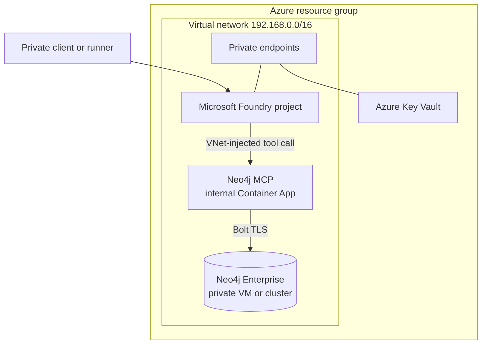

# Neo4j on Microsoft Foundry with private networking

Deploy a Microsoft Foundry project that connects to Neo4j through a private
[Model Context Protocol (MCP)](https://modelcontextprotocol.io/) endpoint. The
template uses the Foundry Basic Agent Setup, so agent state is managed by the
platform and no separate Azure Storage, Cosmos DB, or AI Search deployment is
required.

[Features](#features) · [Getting started](#getting-started) ·
[Resources](#resources) · [Guidance](#guidance)

> [!IMPORTANT]
> This template is intended for evaluation and development. Review the security
> controls, costs, model availability, Neo4j license terms, and your Azure
> policies before adapting it for production.

## Important Security Notice

Public network access is disabled by default for Foundry, Key Vault, the MCP
server, and Neo4j. The bundled Neo4j deployment uses a self-signed Bolt
certificate and Neo4j Enterprise evaluation software. Production deployments
should use an organization-issued certificate, an approved access path, and
the operational controls required by your environment.

The sample dataset is generated and contains no customer or proprietary data.

## Features

- Microsoft Foundry Basic Agent Setup with VNet injection.
- Private Neo4j MCP server hosted on Azure Container Apps.
- Read-only Neo4j user and read-only MCP mode by default.
- Optional Neo4j Enterprise deployment on one or three private Azure VMs.
- Private endpoints and DNS for Foundry and Key Vault.
- Managed identity access to Key Vault; secrets are not returned as deployment
  outputs.
- Cross-platform Azure Developer CLI (`azd`) hooks for setup and ordered
  teardown.
- Synthetic sample data and an end-to-end MCP test.

### Architecture



The VNet contains four `/24` subnets: Foundry agent injection, private
endpoints, the internal Container Apps environment, and Neo4j.

## Resources

| Resource | Purpose |
| --- | --- |
| Foundry resources | Basic Agent Setup with VNet injection |
| VNet | Four isolated subnets |
| Private endpoints and DNS | Private access to Foundry and Key Vault |
| Container Apps | VNet-only Neo4j MCP endpoint |
| Log Analytics workspace | Container Apps logs |
| Key Vault and managed identities | Credential storage and retrieval |
| Neo4j VM and Premium SSD | Optional bundled database; one node by default |
| NAT gateway and public IP | Explicit outbound path for VM bootstrap |

## Getting Started

### Prerequisites

- An Azure subscription with permission to create resources and role
  assignments. The deployer needs Foundry Account Owner plus either Owner, or
  Contributor with Role Based Access Administrator.
- Model quota in the target region. The default deployment is `gpt-5.5`
  version `2026-04-24`, Global Standard, at 30K TPM.
- [Azure Developer CLI](https://learn.microsoft.com/azure/developer/azure-developer-cli/install-azd)
  1.31 or later, Azure CLI, OpenSSL, `ssh-keygen`, Python 3.10 or later, and
  [uv](https://docs.astral.sh/uv/getting-started/installation/) for the sample
  data and agent test.
- A private access path, such as VPN, ExpressRoute, or a VNet-connected runner,
  when Foundry public network access is disabled.

The included Dev Container provides the required command-line tools. The
pre-provision hook registers required Azure resource providers when the
deployer has permission.

### Deploy

Initialize the template in an empty directory:

```bash
azd init --template https://github.com/neo4j-partners/neo4j-foundry-vnet .
az login
azd auth login
azd up
```

The first deployment asks you to accept the Neo4j Enterprise license. It then
generates database credentials and an SSH key in the gitignored `azd`
environment. The VM does not expose SSH publicly.

For non-interactive evaluation deployments, record license acceptance before
running `azd up`:

```bash
azd env set NEO4J_ACCEPT_LICENSE_AGREEMENT yes
azd up --no-prompt
```

To connect the MCP server to an existing Neo4j instance reachable from the
VNet, set its URI and a read-only account. This skips the bundled VMs:

```bash
azd env set NEO4J_URI neo4j+s://your-private-neo4j.example:7687
azd env set NEO4J_AGENT_USERNAME your-read-only-user
azd env set NEO4J_AGENT_PASSWORD your-password
azd up
```

### Load and test the sample

Run these commands from a host that can reach the private Foundry endpoint:

```bash
./load-data.sh
./test-private.sh
uv run agent/create_and_test_agent.py
```

The loader imports a generated wind-turbine graph and removes its temporary
staging account when complete. The tests verify that the MCP endpoint is not
publicly resolvable and that a Foundry agent can call `get-schema` and
`read-cypher`. See [Testing](docs/TESTING.md) for the release checks.

For evaluation from a workstation without private access, you can enable only
the Foundry account's public endpoint. MCP and Neo4j remain private:

```bash
azd env set FOUNDRY_PUBLIC_NETWORK_ACCESS Enabled
azd up
```

Do not use this option with sensitive data.

### Clean up

```bash
azd down --force --purge
```

The pre-down hook removes Foundry capability hosts and dependent resources in
the required order before deleting the resource group. Cleanup usually takes
10–20 minutes. If Azure reports that a service association link is still
present, retry the command later.

## Guidance

### Basic versus Standard Agent Setup

This template uses Basic because the platform manages agent state. Choose
Standard when your requirements call for customer-managed agent Storage,
Cosmos DB, and AI Search.

| Requirement | Basic | Standard |
| --- | --- | --- |
| Agent runtime egress through your VNet | Yes | Yes |
| Platform-managed agent state | Yes | No |
| Customer-managed Storage, Cosmos DB, and AI Search | No | Required |

Microsoft's network-isolation guidance supports private MCP traffic through
the injected subnet with both Basic template 11 and Standard template 15.

### Configuration

| `azd` environment variable | Default | Purpose |
| --- | --- | --- |
| `FOUNDRY_PUBLIC_NETWORK_ACCESS` | `Disabled` | Foundry public access |
| `FOUNDRY_MODEL_NAME` | `gpt-5.5` | Model and deployment name |
| `FOUNDRY_MODEL_VERSION` | `2026-04-24` | Model version |
| `FOUNDRY_MODEL_SKU` | `GlobalStandard` | Model deployment SKU |
| `FOUNDRY_MODEL_CAPACITY` | `30` | Capacity in thousands of TPM |
| `NEO4J_MCP_CONTAINER_IMAGE` | Pinned `neo4j/mcp:v1.5.3` | MCP image |
| `NEO4J_NODE_COUNT` | `1` | Primary count; use `3` for HA testing |
| `NEO4J_VM_SIZE` | `Standard_D4s_v5` | VM size per Neo4j node |
| `NEO4J_DATA_DISK_SIZE_GB` | `256` | Premium SSD size per node |
| `NEO4J_VERSION` | `2026.07.1` | Bundled Neo4j Enterprise version |
| `NEO4J_URI` | empty | Existing private Neo4j URI; skips bundled VMs |
| `NEO4J_READ_ONLY` | `true` | Removes MCP write tools |

### Security

- Foundry and Key Vault use private endpoints and private DNS by default.
- MCP and Neo4j have no public inbound endpoints.
- Network security groups allow Bolt only from the MCP subnet and Neo4j
  cluster traffic only within the Neo4j subnet.
- MCP uses a dedicated Neo4j account with the built-in `reader` role.
- Bicep parameters containing passwords are marked secure. VM managed
  identities retrieve secrets from Key Vault during bootstrap.
- Key Vault public access is enabled only for initial deployment and is disabled
  by the post-provision hook after its private endpoint is ready.
- The bundled database uses `neo4j+ssc://` with self-signed TLS. Use
  `neo4j+s://` and an organization-issued certificate for production.

### Region availability and cost

Foundry, the selected model, and the required VM size must be available in the
chosen region. Check quota before deployment.

The main cost drivers are the Neo4j VM and disk, model usage, Container Apps,
Log Analytics, the NAT gateway, and private endpoints. Use the
[Azure pricing calculator](https://azure.microsoft.com/pricing/calculator/)
for an estimate and delete evaluation environments when finished.

### References

- [Foundry Agent Service networking options](https://learn.microsoft.com/azure/foundry/agents/concepts/networking-options)
- [Foundry MCP tools](https://learn.microsoft.com/azure/foundry/agents/how-to/tools/model-context-protocol)
- [Azure OpenAI model retirement schedule](https://learn.microsoft.com/azure/foundry/openai/concepts/model-retirement-schedule)
- [Foundry Basic VNet template](https://github.com/microsoft-foundry/foundry-samples/tree/main/infrastructure/infrastructure-setup-bicep/11-private-network-basic-vnet)
- [Foundry VNet cleanup tool](https://github.com/microsoft-foundry/foundry-samples/tree/main/infrastructure/infrastructure-setup-bicep/deployment-tools/cleanup)
- [Neo4j MCP server](https://github.com/neo4j/mcp)
